# 🚀 Awesome API Discovery & Cataloging

  <strong>The definitive, curated collection of automated API discovery tools, shadow & zombie API detection engines, eBPF network sniffers, OpenAPI cataloging platforms, and API attack surface management frameworks.</strong>

  
  
  
  
  
  
  

  <a href="#-quick-navigation">Quick Navigation</a> •
  <a href="#-sector-overview--market-dynamics">Sector Overview</a> •
  <a href="#-saas-platforms">SaaS Platforms</a> •
  <a href="#-open-source-tools--frameworks">Open-Source Tools</a> •
  <a href="#-key-concepts--taxonomy">Key Concepts</a> •
  <a href="#-contributing">Contributing</a> •
  <a href="#-support--sponsorship">Support</a> •
  <a href="#-star-history">Star History</a>

---

## 📌 Quick Navigation

- [📊 Sector Overview & Market Dynamics](#-sector-overview--market-dynamics)
- [🏢 SaaS Platforms (Ranked by Scale)](#-saas-platforms)
- [🔓 Open-Source Tools & Frameworks (Ranked by Stars)](#-open-source-tools--frameworks)
- [🧠 Key Concepts & Taxonomy: Shadow, Zombie, & Rogue APIs](#-key-concepts--taxonomy)
- [🤝 Contributing Guidelines](#-contributing)
- [💖 Support & Sponsorship](#-support--sponsorship)
- [📈 Star History](#-star-history)

---

## 📊 Sector Overview & Market Dynamics

The global **API Security, Discovery, and Management Market** is estimated between **$1.2B and $10B** (projected to exceed **$14B by 2032** with a compound annual growth rate of ~25%–30%). 

* **Market Structure:** The industry remains **moderately fragmented** between dedicated runtime cybersecurity pure-plays, internal developer portal (IDP) vendors, API gateway providers, and shifted-left code analysis tools.
* **Consolidation Trend:** A strong **concentration wave** is underway as major cloud and enterprise cybersecurity giants absorb pioneering startups—notably Akamai's $450M acquisition of Noname Security, Cloudflare's integrated API Shield platform, and Postman's acquisition and rollout of Akita technology into Postman Insights.
* **Core Value Drivers:** Explosive microservice sprawl, third-party integrations, and LLM/agentic API endpoints have elevated **Automated Continuous Discovery** and **Shadow API inventorying** from a "nice-to-have" compliance checkbox to an essential baseline of modern DevSecOps.

---

## 🏢 SaaS Platforms

Enterprise SaaS solutions providing automated continuous API discovery, passive eBPF/proxy-based shadow API inventorying, security posture governance, and centralized catalogs. 

> Sorted in descending order by **Company Scale** (Market Cap / Valuation / Revenue).

| 🏢 Vendor / Product | 📈 Company Scale (Valuation / Revenue) | 💵 Starting Tier Pricing | 🎁 Free Tier / Trial Limits | 🔍 Key Discovery & Catalog Capabilities |
| :--- | :--- | :--- | :--- | :--- |
| **[Cloudflare API Shield](https://www.cloudflare.com/application-services/products/api-shield/)** | **$33.15B Market Cap** ($1.67B FY2024 Revenue) | **$25/month** (Pro plan base; automated ML discovery requires Enterprise custom quote) | **Free Plan**: Free forever with up to 10 mTLS client certs & basic rate limiting (Automated ML discovery requires Enterprise evaluation sandbox upon request) | Machine-learning-driven endpoint discovery from Cloudflare edge traffic, schema validation, and sequence mitigation. |
| **[Postman API Catalog & Insights](https://www.postman.com/api-catalog/)** | **$5.6B Valuation** (~$313M ARR) | **$19/user/month** (Team, billed annually; Enterprise at $49/user/month for Insights Agent) | **Free Forever**: 1 user, up to 3 public API definitions, and 50 AI credits; 14-day Enterprise trial available upon request | Deploys eBPF-based Insights Agent into Kubernetes/cloud environments to automatically discover live endpoints and populate Postman API Catalog. |
| **[Salt Security](https://salt.security/)** | **$1.4B Valuation** (~$75M ARR) | **$20,000/year** (Starting baseline AWS Marketplace 12-month tier; enterprise packages scale to $100k/yr) | **No self-serve free plan**; 14-day guided proof-of-concept (PoC) / sandbox evaluation available via sales | Patented big data architecture analyzes continuous API traffic across gateways and cloud providers to automatically inventory all internal and shadow endpoints. |
| **[Traceable AI](https://www.traceable.ai/)** | **$450M+ Valuation** (~$25M–$31M ARR) | **$20,000/year** (AWS Marketplace Discovery tier covering up to 250 API endpoints) | **No self-serve free plan**; 30-day technical proof-of-concept (PoC) and evaluation sandbox available upon sales request | Continuous automated API discovery, sensitive data flow tracking, and behavioral risk profiling using distributed tracing and eBPF sensors. |
| **[Akamai API Security (formerly Noname)](https://www.akamai.com/products/api-security)** | **$450M Acquisition Price** ($452.3M cash deal by Akamai in 2024) | **Custom Enterprise contract** (Annual contract starting at ~$30,000 via AWS Marketplace private offers) | **No self-serve free plan**; 14-to-30-day enterprise evaluation and dark-traffic assessment available via sales request | Integrates agentless network sniffers, cloud mirrors, and API gateways to catalog shadow APIs, legacy endpoints, and anomalous data access. |
| **[Cequence Security](https://www.cequence.ai/)** | **$250M–$500M Est. Valuation** (~$30M–$40M ARR) | **$52,500/year** (AWS Marketplace entry baseline unified security platform annual tier) | **No self-serve free plan**; 14-to-30-day custom Proof-of-Value (PoV) sandbox coordinated via sales engineering | API Spartan & API Sentinel for automated discovery of all managed and unmanaged external APIs, sensitive payload tracking, and bot mitigation. |
| **[42Crunch](https://42crunch.com/)** | **~$25M Funding** (~$5M+ ARR) | **$9/month** (Developer Individual plan; Pro at $20/month) | **Free Forever**: 100 API security audit scans per month via IDE plugins (VS Code, JetBrains) and up to 25 CI/CD scans/month across 3 repositories | Shift-left API discovery and security audit platform that parses OpenAPI definitions in IDEs and CI/CD pipelines to build a unified posture catalog. |
| **[FireTail](https://www.firetail.ai/)** | **~$5M Funding** (~$2M ARR) | **$0/month** (Free Developer tier; Enterprise starting at $6,000/year) | **Free Forever**: Covers up to 5 APIs, 1,000,000 API call logs per month, and 7-day data retention | Hybrid runtime and code-level API security providing inline inspection, continuous automated discovery, and central logging. |
| **[Levo.ai](https://www.levo.ai/)** | **~$4M Funding** (~$3M ARR) | **Custom Per-Endpoint tier** (Custom pricing structured per endpoint rather than request volume) | **14-day Free Trial**: Full access to eBPF auto-discovery sensor and OpenAPI specification generator upon registration | Auto-discovers internal and external APIs via passive eBPF sensors, auto-generating real-time OpenAPI schemas without requiring code changes. |

---

## 🔓 Open-Source Tools & Frameworks

Open-source frameworks, software catalogs, network interceptors, web spiders, and registries for discovering, reverse-engineering, and maintaining API inventories.

> Sorted in descending order by **GitHub Star Count**. Click on any star badge to view stargazers!

| 📦 Project & Stargazers Badge | 📝 Description | ⚙️ Primary Discovery / Catalog Mechanism |
| :--- | :--- | :--- |
| **[mitmproxy](https://github.com/mitmproxy/mitmproxy)**  | Interactive, SSL/TLS-capable intercepting HTTP proxy for penetration testers and developers. | Intercepts live network traffic to inspect payloads, reverse-engineer undocumented endpoints, and export HTTP flows into OpenAPI definitions. |
| **[Backstage](https://github.com/backstage/backstage)**  | Spotify's open-source framework for building internal developer portals (IDPs). | Software Catalog core that tracks `kind: API` entities, OpenAPI/AsyncAPI/GraphQL specifications, ownership, and service dependency graphs. |
| **[Swagger UI](https://github.com/swagger-api/swagger-ui)**  | Visual documentation and exploration collection for OpenAPI specifications. | Serves as an interactive catalog viewer and discovery UI for exposed OpenAPI 2.0/3.x specifications across distributed microservices. |
| **[Katana](https://github.com/projectdiscovery/katana)**  | Next-generation crawling and spidering framework by ProjectDiscovery. | Discovers unmapped and hidden API endpoints, query routes, and endpoints through automated headless crawling and JavaScript parsing. |
| **[Prism](https://github.com/stoplightio/prism)**  | Open-source HTTP mock and proxy server powered by OpenAPI v2/v3 documents. | Validates live traffic against API schemas, logging contract drifts, missing endpoints, and shadow parameters. |
| **[APIs-guru OpenAPI Directory](https://github.com/APIs-guru/openapi-directory)**  | The "Wikipedia for Web APIs" containing machine-readable specifications. | Massive catalog of thousands of public REST API definitions formatted in OpenAPI 2.0/3.x, serving as a global benchmark and discovery directory. |
| **[kin-openapi](https://github.com/getkin/kin-openapi)**  | OpenAPI 3.0 (and 3.1) implementation for Go (router, validator, parser). | Programmatically inspects, merges, and validates OpenAPI specs from Go services to power custom cataloging systems and discovery pipelines. |
| **[Akto](https://github.com/akto-api-security/akto)**  | Open-source API security platform that discovers APIs and tests for business logic vulnerabilities. | Integrates with AWS, GCP, Cloudflare, Kubernetes DaemonSets, and traffic mirrors to continuously discover and catalog shadow endpoints and sensitive data. |
| **[Optic](https://github.com/opticdev/optic)**  | Git-native API documentation, automated changelog generation, and schema diffing tool. | Observes API traffic in test/dev environments to generate OpenAPI schemas automatically, catch breaking changes, and track version history. |

---

## 🧠 Key Concepts & Taxonomy

Understanding the taxonomy of API discovery and attack surface management:

* **👻 Shadow APIs**: Endpoints actively deployed and serving real traffic that are uncataloged, undocumented, or bypassing security controls without SecOps team visibility.
* **🧟 Zombie APIs**: Deprecated, superseded (v1 vs. v2), or abandoned endpoints that remain active in infrastructure and serve as prime targets for malicious exploitation.
* **🛡️ Attack Surface Management (ASM)**: Continuous discovery, inventorying, and classification of all internet-facing and internal digital API assets.
* **⚡ eBPF (Extended Berkeley Packet Filter)**: Kernel-level inspection mechanism that passively mirrors and parses network calls with near-zero latency overhead to uncover live routes.

---

## 🤝 Contributing

Contributions are warmly welcomed! Please read our [CONTRIBUTING.md](CONTRIBUTING.md) guide before submitting a PR.
* Missing an innovative discovery scanner or IDP catalog? Open a PR!
* Suggesting new commercial features or open-source libraries? Follow the tabular structure.

---

## 💖 Support & Sponsorship

If you find this curated catalog and market landscape valuable:
- ⭐ **Star this repository** to help others discover it!
- 🍴 **Fork it** and build your own custom organizational catalog!
- 📢 **Share it** on LinkedIn, X/Twitter, Reddit, or Discord!

☕ Want to support ongoing maintenance and new security research? You can buy me a coffee through the GitHub Sponsor dashboard:

  

Thank you for being part of the open-source community! 🙌

---

##  Star History

---

  Maintained with ❤️ by <a href="https://github.com/ishandutta2007">Ishan Dutta</a>. Released under the MIT License.

